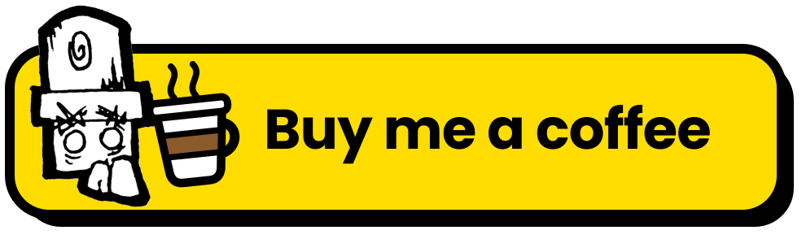

# cc-vita

A native PS Vita port of Castle Crashers (the original, classic look, not Remastered). A custom engine runs the game's own Flash content and ActionScript from your copy of the game, drawn on the Vita's GPU at full speed.

**No game data is included, and none may ever be committed (see `.gitignore`).** You need your own copy of Castle Crashers on PC (Steam). The app reads the data files from it at runtime. Please don't ask for or share game files.

## Install

You need a PS Vita with HENkaku or Ensō and VitaShell, plus your own Steam copy of Castle Crashers on a PC.

### 1. Install the app

1. Get `cc-vita.vpk` from this repository's [releases](https://github.com/unclejahjah/cc-vita/releases/latest), or build it yourself (see [Building](#building)).
2. Copy the VPK to the Vita, for example to `ux0:downloads/`.
3. In VitaShell, open the VPK and press Cross to install it. The "Castle Crashers" bubble appears on the home screen.

To update, install the new VPK over the old one. Your save and settings are kept.

### 2. Get the data files from your PC copy

In Steam, right-click Castle Crashers and choose Manage, then Browse local files. Copy the whole folder somewhere else first and work on the copy, never on the Steam folder itself.

The game's `data/game/*.pak` and `data/levels/*.pak` files are encrypted. Unpack them with the community Castle Mod Tool, which turns each `.pak` into a `.swf` file (for example `game/MAIN.pak` gives `MAIN.swf`).

You'll need these from your copy:

| On the Vita | Comes from | Needed for |
| --- | --- | --- |
| `game/*.swf` | `data/game/*.pak`, unpacked | The game itself (`MAIN.swf`, `MENU.swf`, `PLAYER.swf`, ...) |
| `levels/*.swf` | `data/levels/*.pak`, unpacked | The levels (`LEVEL1.swf`, ...) |
| `fonts/synjUnicode_20.fnt` and `fonts/synjUnicode_20_0.dds` | `data/fonts/` | All menu text |
| `sfx/*.mp3` | `data/sounds/*.xma`, with [`tools/convert_audio.py`](tools/convert_audio.py) | Sound effects |
| `music/*.mp3` | `data/music/*.xma`, with [`tools/convert_audio.py`](tools/convert_audio.py) | Music |
| `strings_en.txt` | `castle.exe`, with [`tools/extract_strings.py`](tools/extract_strings.py) | Menu and map text |
| `strings_help_en.txt` | `castle.exe`, with [`tools/extract_help.py`](tools/extract_help.py) | Help & Options pages |

Make the two text files on the PC, from a copy of `castle.exe` (Python 3):

```
python tools/extract_strings.py --exe "<your copy>/castle.exe" --out <folder>
python tools/extract_help.py --exe "<your copy>/castle.exe" --out strings_help_en.txt
```

`extract_strings.py` writes one `strings_<language>.txt` per language. You need `strings_en.txt`.

#### Make the sound files

You need Python 3 and ffmpeg (`winget install Gyan.FFmpeg` on Windows, `sudo apt install ffmpeg` on Debian or Ubuntu, `brew install ffmpeg` on macOS). Then run:

```
python tools/convert_audio.py --data "<your copy>/data" --out <folder>
```

This writes `<folder>/sfx/` and `<folder>/music/`, 466 MP3 files in all, keeping each file's name. Copy both folders to the Vita in the next step. The 17 `PBP_*.mp3` files aren't used yet, so you can leave them out.

### 3. Copy the data to the Vita

1. Connect the Vita to the PC. You can use VitaShell's FTP server (press Select in VitaShell, then connect an FTP client such as FileZilla or WinSCP to the address it shows, with no login), or its USB mode. Keep the Vita awake while copying.
2. On the Vita, create the folder `ux0:data/CastleCrashers/`.
3. Copy the files into it as shown below. Don't rename the `.swf` files.

When you're done, it should look like this:

```
ux0:data/CastleCrashers/
├── game/MAIN.swf          (and the other game .swf files)
├── levels/LEVEL1.swf      (and the other level .swf files)
├── fonts/synjUnicode_20.fnt
├── fonts/synjUnicode_20_0.dds
├── sfx/*.mp3
├── music/*.mp3
├── strings_en.txt
└── strings_help_en.txt
```

Check that each folder holds its files directly. A common mistake is ending up with `ux0:data/CastleCrashers/data/game/` or `game/game/`.

Optional extras:
- **Volleyball** (the PS3 mini game) needs `VMENU.swf` from your own PS3 copy, in `game/`.
- **Custom characters and a custom pet** go in `custom/` and `custom/animal/`. The release notes explain how to make them.

### Sound and music

Without `sfx` or `music` the game still runs, just without that kind of sound. If there's no sound:
- Check that the files are in `ux0:data/CastleCrashers/sfx/` and `ux0:data/CastleCrashers/music/`, not in a subfolder.
- Check the Music and SFX volumes in Help & Options, then Settings.
- Check the Vita's own volume.

### 4. Start the game

Tap the bubble. If `MAIN.swf` is missing, the app says so instead of starting. For anything else that's missing, `ux0:data/CastleCrashers/log.txt` says which file and where it expected it. Include that file with any bug report.

## Controls

| Button | Action |
| --- | --- |
| Left stick | Move: a light tilt walks, a full tilt runs |
| D-pad | Run, menu selection |
| Square | Light attack |
| Triangle | Heavy attack |
| Cross | Jump, accept |
| Circle | Use item, back |
| L | Block |
| Hold R + an attack | Magic |
| Right stick flick | Switch item (touch can do this too, see Settings) |
| Start | Pause |
| Select + Up | Stats overlay |

Buttons can be remapped in Help & Options, then Controls.

## Settings

Help & Options, then Settings: Music and SFX volume, Auto Potion, Item Switch (right stick, front or rear touch), HUD Size (Small to Extra Large), Menu Text Size (Normal to Extra Large), and on the title screen's Settings, FRESH Look (BETA).

## Saves

Progress, characters and unlocks are kept in `ux0:data/CastleCrashers/save.dat`, settings in `settings.txt` and achievements in `achievements.dat`, all in the same folder. Back them up before deleting the app's bubble.

## Multiplayer (BETA)

Wi-Fi co-op Vita to Vita, and online co-op by game code (the host's router needs UPnP), up to 4 players. Every player needs the same version. Custom characters and pets are off in Wi-Fi and online games. On a Vita TV, extra controllers can join local co-op.

## Not working

- Trophies.
- Steam Workshop characters (their files are encrypted).

## Building

With [VitaSDK](https://vitasdk.org) installed and `VITASDK` set, plus libmpg123 for the Vita in the SDK:

```
mkdir build && cd build
cmake ..
make
```

This builds `cc_vita.vpk`.

### LiveArea art

The bubble and LiveArea art are made from the game's art, so they stay out of the repository. `tools/livearea/make_livearea.sh GAME_DIR FONTS_DIR OUT` renders them from your game files, then `cmake -DLIVEAREA_DIR=OUT ..` puts them in the VPK. A build without them gets the default LiveArea.

## Desktop harness

`tools/hosttest.c` builds the engine for Linux or WSL and writes frames as PPM images, so changes can be checked without a Vita. Its options and environment variables are listed in [`HANDOFF.md`](HANDOFF.md), along with the project's current state and the facts that cost time to find.

## How it works

- `src/swf.c` parses the game's SWF files: shapes, sprites, timelines and ActionScript.
- `src/as_*.c` is an ActionScript 1/2 interpreter that runs the game's own scripts. The parts of the game that live in `castle.exe` (menus, pause menu, saves, natives the scripts call) are reimplemented in `src/cc_host.c`, `src/cc_native.c`, `src/pause_menu.c` and `src/help_book.c`.
- `src/render.c` tessellates each shape once with libtess2 and caches it. Each frame becomes one triangle list for the GPU. Masks use the stencil buffer.
- `src/audio.c` mixes the sound effects and streams the music with libmpg123.
- `src/main.c` is the Vita app.
- `third_party/libtess2` is vendored from memononen/libtess2 (SGI Free Software License B), see its `VERSION`.

`sce_gap.ld` works around a VitaSDK quirk: `vita-elf-create` fails with "segment 1 overlaps" when the code happens to end just below a 64 KB boundary.

## License

The source code is under the MIT License, see `LICENSE`. That does not cover Castle Crashers or any of its art, audio, data or names, which belong to The Behemoth.

---

<p align="center">
  <a href="https://buymeacoffee.com/sirjahjah">
    
  </a>
</p>
